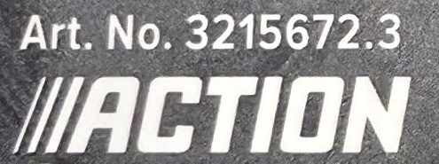

<a href="https://leotech.cz"><picture><source media="(prefers-color-scheme: dark)" srcset="docs/web/leotech_logo_dark.svg"></picture></a>

# LSC Smart Connect 3215672.3 – local firmware (ak_rtsp · leotech edition)

**English** · [Česky](#česky)

| ✅ Compatible camera / Kompatibilní kamera | |
|---|---|
| **Action – LSC Smart Connect indoor IP camera 1080p** **Art. No. 3215672<u>.3</u>** – the **.3** is important (printed on the box) Anyka AK3918AV130 · 2.4 GHz Wi-Fi (WPA/WPA2) |  |

> ❗ **The `.3` at the end matters!** Check the **Art. No.** on the box before you start – it must be **3215672<u>.3</u>**.
> The same item number without the suffix (`3215672`) is a completely different camera inside (Ingenic SoC) and is **not** supported here.
>
> ❗ **Tečka a trojka na konci jsou důležité!** Zkontroluj **Art. No.** na krabici – musí být **3215672<u>.3</u>**.
> Stejné číslo bez přípony (`3215672`) je uvnitř úplně jiná kamera (čip Ingenic) a **není** podporovaná.

> 📵 **After installing, the original LSC Smart Connect app and the Tuya cloud no longer work with this camera**
> (no app, no cloud recording, no notifications, the Tuya device licence/pairing is not used).
> You can go back at any time – **[how to restore the original firmware](docs/RESTORE.md)**.
>
> 📵 **Po instalaci přestane s kamerou fungovat původní aplikace LSC Smart Connect i cloud Tuya**
> (žádná aplikace, cloudové nahrávání ani notifikace, licence/párování Tuya se nepoužívá).
> Kdykoli se dá vrátit – **[návod na návrat původního firmwaru](docs/RESTORE.md)**.

> 💡 **Do not connect a new camera to the LSC Smart Connect app / cloud before installing.** It may download a newer
> firmware over the internet that has **not been tested** – the installer would refuse it (nothing is written).
> 💡 **Novou kameru před instalací nepřipojuj k aplikaci LSC / cloudu.** Může si stáhnout novější firmware, který
> **není otestovaný** – instalátor ho odmítne (nic nezapíše).

> ⚠️ **USE AT YOUR OWN RISK.** Flashing custom firmware can permanently brick the camera, void the warranty and
> violate the terms of the original app/cloud. Everything here is provided **"AS IS", without any warranty**, and
> **the authors accept no responsibility or liability** for any damage, data loss or other consequences. Make your
> own backup and only proceed if you understand what you are doing.

Cloud-free firmware for the cheap **Action "LSC Smart Connect" indoor IP camera** – no Tuya cloud, no app,
just your local network: RTSP for Frigate/VLC, a web page, MQTT with Home Assistant auto-discovery, speaker,
Wi-Fi setup by QR code and over-the-air updates.

## Which camera?

| | |
|---|---|
| Product | **LSC Smart Connect – Inteligentní vnitřní IP kamera 1080p** (Action, item **3215672**) |
| **Required version** | "Art. No." on the box must be **3215672.3** (tested). `.1` / `.2` use the same Anyka SoC and will probably work; the plain **3215672** (no suffix, Ingenic T23) is a **different camera** – use [Thingino](https://github.com/themactep/thingino-firmware/wiki/Camera:-LSC-3215672) for it |
| SoC | Anyka **AK3918AV130**, 64 MB RAM, 8 MB SPI NOR flash |
| Shop | e.g. [action.com – 3215672](https://www.action.com/pl-pl/p/3215672/inteligentna-wewnetrzna-kamera-ip-lsc-smart-connect/) (sold in Action stores across the EU, 2026) |

The installer checks the flash layout and the exact MD5 of the original firmware; an unknown camera or firmware
version is refused and **nothing is written**.

## Features

- **RTSP** 1920×1080 H.264 (+ audio) – works with Frigate (incl. Intel VAAPI), go2rtc, VLC
- **Web page** (`http://<camera-ip>/`), Czech/English by browser language, optional password:
  day/night mode, IR LED, status LED, flip/mirror, brightness/contrast/saturation/sharpness, snapshot preview,
  sounds (upload any MP3/WAV – converted in the browser), MQTT settings, camera name, firmware update
- **MQTT + Home Assistant discovery** – selects, switches, sliders, a button for every sound, restart
- **Speaker** – built-in and user sounds, play from HA (`mqtt.publish … /play`), live stream to TCP 8093
- **Wi-Fi by QR code** – hold the reset button 2 s and show the phone's "share Wi-Fi" QR code; falls back to the
  previous network if the new one does not connect
- **Reset button** – short press: the camera **says its IP address** (EN + CZ) · 2 s QR Wi-Fi · 5 s clear web password · 15 s defaults (Wi-Fi is never erased)
- After a successful Wi-Fi setup by QR code the camera also announces its new IP address
- **Voice prompts** (English + Czech) during installation and setup
- **OTA** firmware updates from the web page (MD5 verified, automatic rollback)
- Persistent settings, IR LED independent of day/night, status LED control

## How it works / installation

| Step | Needs |
|---|---|
| First install on a stock camera | microSD card (FAT32) prepared on **[the SD card page](https://leontech.github.io/lsc-camera-leotech/)** – the camera builds the firmware itself from its own original firmware ([INSTALL.md](docs/INSTALL.md)) |
| Updates | the camera's web page (System → Firmware update) |
| **Back to the original firmware** | [docs/RESTORE.md](docs/RESTORE.md) – web page or SD card, from your backup |
| Building from source | Linux (or WSL), see [docs/BUILD.md](docs/BUILD.md) |

**Why is there no ready-made firmware image to download?** The image contains parts of the camera's *own* original
firmware (kernel modules, Anyka libraries) which belong to the manufacturer and cannot be redistributed. So the
camera builds the image itself: it backs up its original firmware to the card, unpacks it, removes the Tuya app,
adds ak_rtsp and packs the new image – no PC tools needed.

## Credits & licences

| Part | Author | Licence |
|---|---|---|
| ak_rtsp firmware (base of this project) | [FluxAlchemist/LSC_AK3918AV130_cam_custom_firmware](https://github.com/FluxAlchemist/LSC_AK3918AV130_cam_custom_firmware) | MIT |
| Installer wizard (first flash from Linux) | [4ddict/Action-Smart-Connect-Flasher](https://github.com/4ddict/Action-Smart-Connect-Flasher) | MIT |
| SD-card boot hook toolkit | [tasarren/lsc-tuya-toolkit](https://github.com/tasarren/lsc-tuya-toolkit) | not bundled here – downloaded from its own repository |
| RTSP library | [OpenIPC/smolrtsp](https://github.com/OpenIPC/smolrtsp) | MIT |
| QR decoder | [dlbeer/quirc](https://github.com/dlbeer/quirc) | ISC |
| leotech additions (web, MQTT, speaker, QR Wi-Fi, OTA, button, SD installer, voice tool) | Leoš Vilím / [leotech.cz](https://leotech.cz) | MIT |

This project is not affiliated with Action, LSC, Tuya or Anyka. All trademarks belong to their owners.

If this saved you some time: [☕ ko-fi.com/leotechcz](https://ko-fi.com/leotechcz)

---

## Česky

> ⚠️ **VŠE NA VLASTNÍ RIZIKO.** Nahrání vlastního firmwaru může kameru trvale zničit, ukončit záruku a porušit
> podmínky původní aplikace/cloudu. Vše je poskytováno **„tak jak je“, bez jakékoli záruky** a **autoři nenesou
> žádnou odpovědnost** za škody, ztrátu dat ani jiné následky. Udělej si zálohu a pokračuj jen pokud víš, co děláš.

Firmware bez cloudu pro levnou **vnitřní IP kameru LSC Smart Connect z Action** – bez Tuya cloudu a bez aplikace,
jen v lokální síti: RTSP pro Frigate/VLC, webová stránka, MQTT s automatickým přidáním do Home Assistant,
reproduktor, nastavení Wi-Fi QR kódem a aktualizace po síti.

**Kamera:** LSC Smart Connect vnitřní IP kamera 1080p z Action, **Art. No. 3215672.3** (na krabici, viz fotka nahoře).
Verze `.1`/`.2` mají stejný čip Anyka a pravděpodobně budou fungovat; kamera s číslem jen **3215672** (bez přípony,
čip Ingenic) je **jiná** – pro ni je [Thingino](https://github.com/themactep/thingino-firmware/wiki/Camera:-LSC-3215672).
Instalátor kontroluje rozložení flash a přesné MD5 původního firmwaru – neznámou kameru/verzi odmítne a **nic nezapíše**.

- **Původní aplikace LSC Smart Connect a cloud Tuya po instalaci nefungují.** Návrat: [docs/RESTORE.md](docs/RESTORE.md)
- **Novou kameru před instalací nepřipojuj k aplikaci LSC / cloudu** – může stáhnout nový, neotestovaný firmware.
- **Instalace:** microSD karta (FAT32) připravená na [stránce pro kartu](https://leontech.github.io/lsc-camera-leotech/) – firmware si kamera sestaví sama ze svého originálu ([docs/INSTALL.md](docs/INSTALL.md))
- **Aktualizace:** webová stránka kamery (Systém → Aktualizace firmwaru)
- **Sestavení ze zdrojáků:** Linux / WSL – [docs/BUILD.md](docs/BUILD.md)
- **Proč tu není hotový obraz ke stažení?** Obraz obsahuje části původního firmwaru výrobce, které nesmíme šířit – proto
  si ho kamera sestaví sama ze zálohy svého originálu.

Projekt nemá nic společného s firmami Action, LSC, Tuya ani Anyka.
Pokud ti to ušetřilo čas: [☕ ko-fi.com/leotechcz](https://ko-fi.com/leotechcz) · [leotech.cz](https://leotech.cz)
